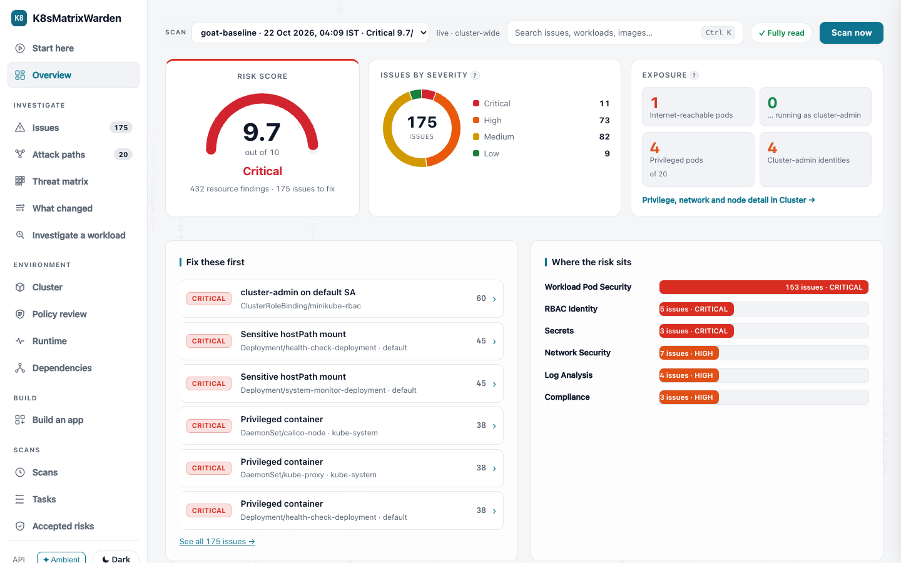
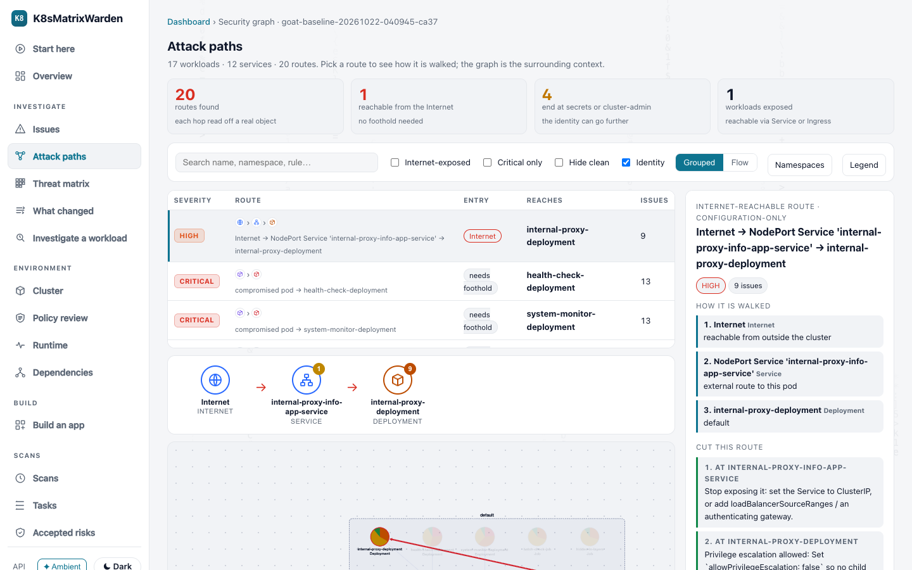
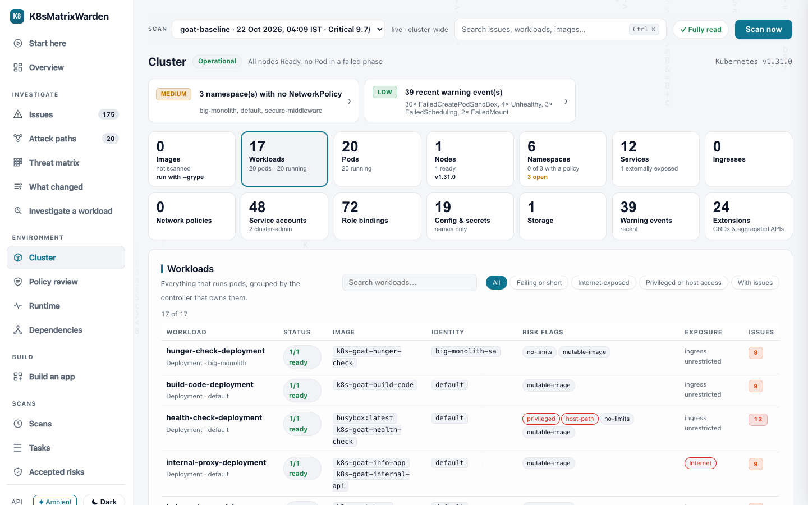
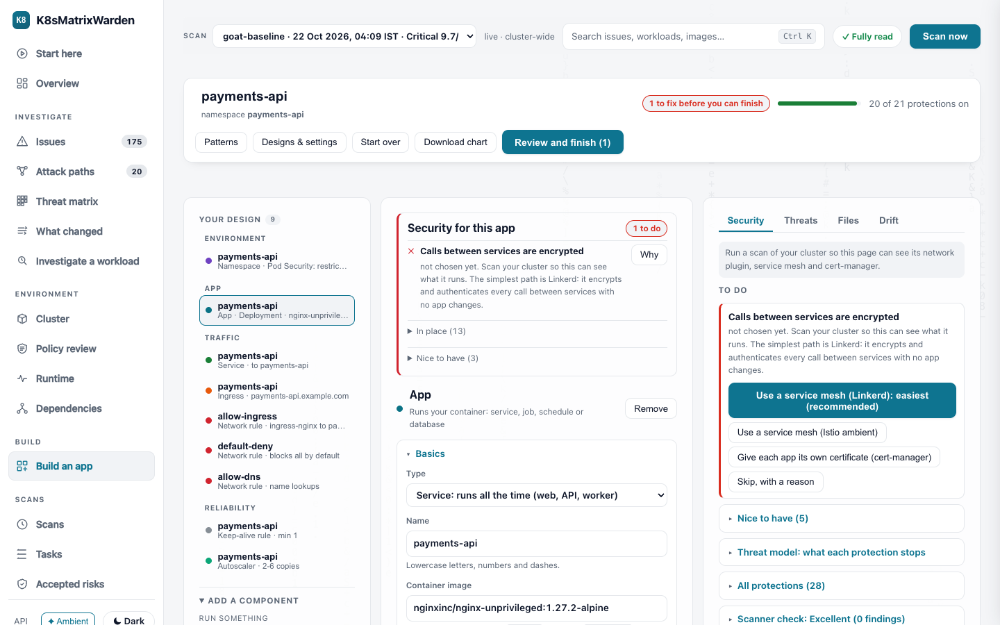
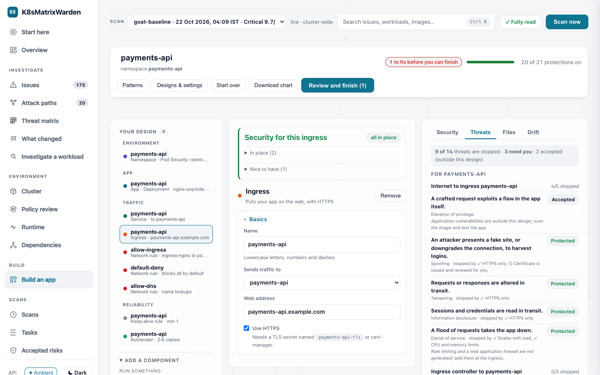
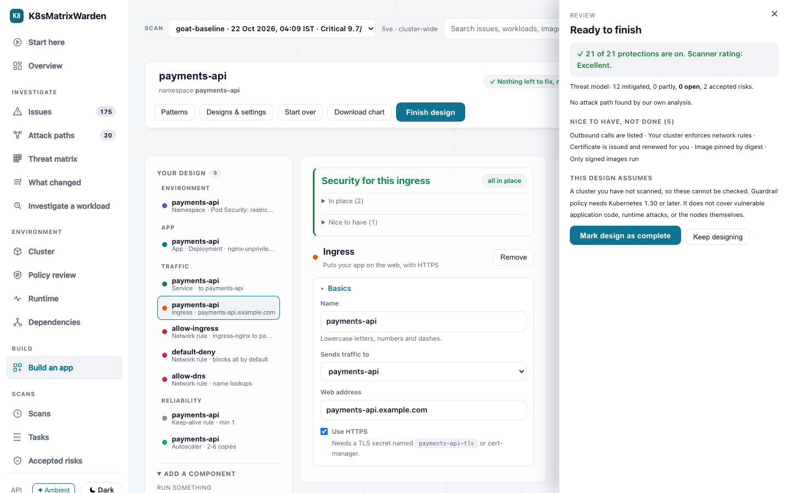
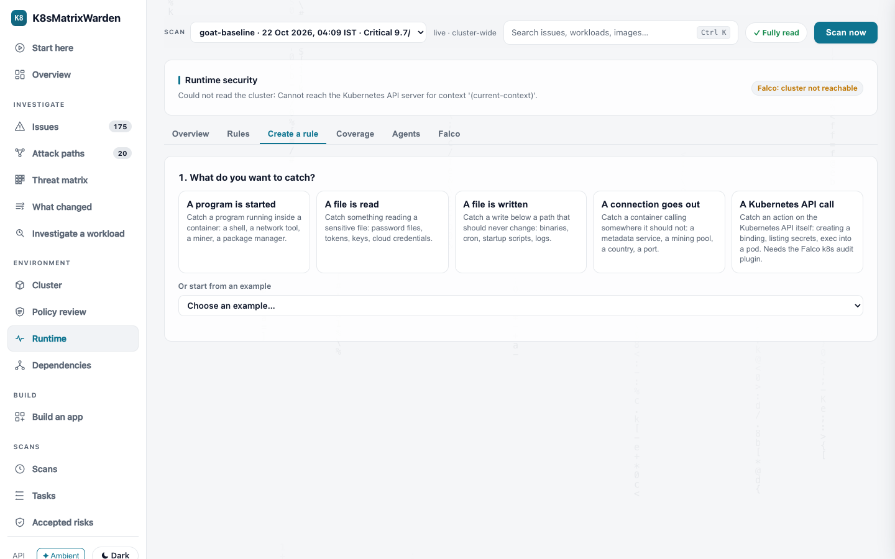

<h1 align="center">K8sMatrixWarden</h1>

<p align="center">
  <strong>Design, assess and defend Kubernetes through one attack-path model</strong><br/>
  <em>From "how should I build this securely?" to "how would an attacker move through it?" to "is it happening right now?"</em>
</p>

<p align="center">
  
  
  
  
  
</p>

<p align="center">
  <a href="GETTING-STARTED.md"><strong>Getting Started</strong></a> ·
  <a href="#proof-kubernetes-goat">Benchmarks</a> ·
  <a href="K8sMatrixWarden-doc.html">Technical Reference</a>
</p>

---

## Demo

| Video | Shows |
|---|---|
| **[Full walkthrough](https://github.com/rohitsoni1209/K8sMatrixWarden/raw/refs/heads/main/K8sMatrixWarden-working.mp4)** | Scan, correlation, attack paths, and dashboard, end to end. |

---

## One model, four jobs

Kubernetes security is split across tools that never talk to each other: one for design
reviews, one for config scanning, one for runtime, one for images. You reconcile them by hand
and still miss how an attacker would chain them. K8sMatrixWarden covers the whole lifecycle
from one model of how an attacker moves through your cluster.

| | What you do | Where |
|---|---|---|
| **Design** | Drag components into a canvas. Get a hardened Helm chart, admission policy, network policies and mTLS, with a live STRIDE threat model that shows which protection each component needs, as you design. | *Build an app* |
| **Assess** | Scan a live cluster read-only. See the attack graph (RBAC, NetworkPolicy reachability, exposure), ranked fix-first issues, and a namespace-to-pod drill-down with the minimum context an engineer needs. | *Overview, Issues, Attack paths, Cluster* |
| **Defend** | Correlate findings with live Falco events. Write and test Falco rules from guided forms before deploying. See which nodes and pods run your security agents. | *Runtime* |
| **Know your software** | An SBOM for every running image, the vulnerable packages in it, direct versus indirect dependencies, and which packages the container really loads. | *Dependencies* |



<table>
<tr>
<td width="50%"><br/><sub><b>Attack paths.</b> Every hop is read off a real object, with the fix that cuts the route.</sub></td>
<td width="50%"><br/><sub><b>Cluster profiles.</b> Workloads, identity, exposure and risk flags in one place, no CLI back and forth.</sub></td>
</tr>
<tr>
<td><br/><sub><b>Design.</b> The protections each component needs appear while you design, not after.</sub></td>
<td><br/><sub><b>Threat model.</b> Threats stopped, partly stopped or open for the component you are editing, with the fix next to each.</sub></td>
</tr>
<tr>
<td><br/><sub><b>Finish.</b> A review of what is protected, what you accepted and why, then mark the design complete.</sub></td>
<td><br/><sub><b>Runtime.</b> Guided Falco rule creation. Pick what to catch, fill fields, test, then deploy.</sub></td>
</tr>
</table>

---

## The problem

A configuration scanner tells you a Pod **can** run privileged. A runtime sensor sees a
syscall only a privileged Pod could make. Nothing connects the two, so every finding arrives
with the same urgency and a team of five triages four hundred of them by hand.

K8sMatrixWarden closes that gap:

> Found 358 static weaknesses. Of those, **4 are being exploited right now**. Here is how the
> attacker chains them.

| | Trivy | kubescape | Falco | kube-bench | **K8sMatrixWarden** |
|---|:---:|:---:|:---:|:---:|:---:|
| Config weaknesses | Yes | Yes | No | Yes | **Yes** |
| Runtime behavior | No | No | Yes | No | **Yes** |
| Correlates both | No | No | No | No | **Yes** |
| Attack path | No | No | No | No | **Yes** |
| Image CVEs | **Yes** | Yes | No | No | Yes (Grype, plus an SBOM per image) |

Trivy is deeper on image scanning. Run both if image depth matters to you.

---

## Quick start

One command, and it tells you what to fix first.

```bash
pip install -e ".[live,manifests]"     # live = real clusters, manifests = YAML and Helm

k8smatrixwarden check                  # the cluster kubectl points at
k8smatrixwarden check ./k8s ./charts   # manifests and Helm charts, before deploy (no cluster)
k8smatrixwarden web                    # dashboard: Overview, Attack paths, Cluster, Build, Runtime, Dependencies
k8smatrixwarden topology               # who can reach whom (exposure paths)
```

Or without installing Python: `docker build -t k8smatrixwarden .` then
`docker run --rm -v "$PWD/k8s:/work:ro" k8smatrixwarden check /work --fail-on HIGH`.

**In the dashboard (built for someone new).** *Start here* walks through five steps with live
status. *Policy review* explains the six settings that limit damage (network rules, Pod Security,
admin access, quotas, dangerous pod settings, what is open to the internet) in plain words.
*Build an app* is drag-and-drop: drop components on a canvas, keep the safe defaults, watch the
protections and threat model for each component update live, then finish the design and download a ready Helm chart. No YAML, no scripts. *Runtime* lists the Falco rules deployed, creates new ones from guided forms with tests, and shows security-agent coverage per node. *Dependencies* shows what every running image contains and which parts are loaded. *What changed* compares two scans (a new internet-facing service, a wider permission, an image change) and flags what made the cluster easier to attack. *Investigate a workload* pulls its status, warnings, changes, risks and attack path onto one page, with an evidence-first containment checklist whose commands you copy and run yourself. *Tasks* runs scans. Press **Ctrl/Cmd+K** (or `/`) anywhere to search issues, workloads, images and pages.
It only reads your cluster and never applies anything.

**What you get.** A ranked list: severity, then whether an attacker can reach it (Internet,
or an identity that reaches secrets), each with the fix. Add `--grype` to scan the running
images for CVEs (needs [Grype](https://github.com/anchore/grype)).

**In CI.** `--fail-on HIGH` exits 1; `--baseline base.json` makes only findings *new in this
change* count; `--comment-file` writes the PR comment; `-o sarif` feeds GitHub code scanning.
A ready workflow is in [examples/ci](examples/ci/github-actions.yml) and a reusable
[action.yml](action.yml).

**Living with findings.** Accept a risk with a reason and an expiry, in
`.k8smatrixwarden-ignore.yaml` or from the dashboard's *Accepted risks* page:

```yaml
suppressions:
  - rule: workload-run-as-root
    resource: "shop/Deployment/web"
    reason: "vendor image, ticket SEC-142"
    owner: alice
    expires: 2026-12-31
```

**For teams.** Issues carry an owner (from the `team` / `owner` label, then the namespace) and
the dashboard filters by it; `k8smatrixwarden notify` posts a summary to Slack. To run it
inside the cluster: `helm install warden ./charts/k8smatrixwarden` (read-only RBAC, scans
every 6 hours, dashboard behind `kubectl port-forward`).

The demo cluster still works with no cluster at all: `k8smatrixwarden scan --mock`.

**New to the product?** The **[Getting Started Guide](GETTING-STARTED.md)** takes you from
zero to a production scan.

---

## What it does

**1. Scan.** 55 rules across 7 domain shards. A shard is the execution boundary: it owns
its rules, its evidence fetch, and its scoped RBAC role.

`workload_pod_security` · `rbac_identity` · `network_security` · `secrets` ·
`compliance` · `attack_surface` · `log_analysis`

Select any of them with `--module <name>`.

**2. Correlate.** Joins findings to live Falco and Kubernetes audit events. A verdict of
`confirmed` means the event named the exact resource the finding sits on. `corroborated`
means same tactic and namespace with no resource link. `runtime-only` means novel behavior.

**3. Prioritize.** Every workload finding is tagged with its live attack vector, computed
from Service and Ingress exposure, NetworkPolicy isolation, and the pod's ServiceAccount
RBAC:

| Tag | Meaning |
|---|---|
| **internet-reachable** | External traffic routes to this pod and no NetworkPolicy isolates it. Fix now. |
| **post-breach only** | Exploitable only by an attacker already inside a pod. |
| **rbac-escalation** | This pod's ServiceAccount can reach cluster-admin. |

This turns a flat list into a queue, for example 368 findings becoming 74 fix-now and 270
deprioritizable, **without ever lowering a severity or hiding a finding**.

**4. Explain.** Attack paths in two layers. The *tactic* chain runs Initial Access through
Impact. The *resource* chain runs Internet, Service, Pod, ServiceAccount, RoleBinding,
ClusterRole, permission, where **every hop is read off a real object** and carries the reason
it exists. Two findings sharing a tactic are never claimed to be connected.

**5. Report.** Seven formats: terminal, text, markdown, JSON, SARIF, HTML, and a ranked
"fix this first" brief. With CIS Benchmark v1.8 (130 controls), MITRE ATT&CK for
Containers, and OWASP Kubernetes Top 10 mapping.

**6. Design.** The builder turns a design into hardened manifests: Pod Security `restricted`,
default-deny NetworkPolicy with narrowed allow rules, resource limits, probes, a
ValidatingAdmissionPolicy (CEL) guardrail, optional Kyverno image-signature policy, and service
mesh or cert-manager mTLS. A STRIDE threat model with trust boundaries is evaluated against the
generated network rules in parallel with the design. Loosening a control needs a business
reason and its compensating controls. Nothing is applied: it outputs a Helm chart.

**7. Defend.** The Runtime tab lists every deployed Falco rule in plain words, creates rules from
guided forms (one predicate list renders the Falco condition and tests it against sample
events), deploys Falco with a safe opt-in, and reports MITRE coverage and security-agent
coverage (health, version, per node and pod).

**8. Know your software.** Syft builds an SBOM for each running image by digest, Grype matches
it, and a read-only look inside the container shows which packages are loaded.
Direct and indirect dependencies come from the SBOM where the ecosystem records them.
CycloneDX and SPDX export. Needs `syft` and `grype`.

---

## Proof

**Kubernetes Goat** on a throwaway minikube (Kubernetes 1.31, Calico), measured with this build:

| Metric | Result |
|---|---|
| Findings | **432** resource findings become **175** issues to fix (11 critical, 73 high), risk **9.7/10** |
| Attack routes | **20** evidence-backed routes, **1** reachable from the Internet (`Internet -> NodePort Service -> Deployment/internal-proxy`) |
| Caught | privileged containers, host PID/IPC/network, Docker socket and writable hostPath mounts, cluster-admin default service account, wildcard RBAC, open metadata API, no NetworkPolicy, secrets in environment variables, NodePort exposure, missing limits, root user |
| Not caught (yet) | secrets baked into image layers, an unauthenticated registry, a crypto-miner image, secrets in a build repository |
| Image CVEs | five known-vulnerable images (Log4Shell, Apache 2.4.49, Struts 2.3.30, an old ingress-nginx, Redis 5.0.5) were all flagged by `--grype` |

**DVKA** (Damn Vulnerable Kubernetes Application, in [`eval/`](eval/README.md)) has an answer key,
so accuracy is measured rather than claimed. Reproduce with `python3 eval/run_eval.py`:

| Measure | Result |
|---|---|
| Recall (planted weaknesses detected) | **100%** (115 of 115) |
| Precision (reported findings correct) | **99.1%** (115 of 116) |
| Documented gaps confirmed undetected | 9 of 9 |
| Internet-to-secrets attack path found | yes |
| Same flaw, exposed vs isolated | exposed scores higher (65.6 vs 46.9) |

The benchmark is the project's own, so read it as a regression guard, not an independent audit.
Cloud IAM has no Kubernetes API path on a local cluster, so it is reported as **unread**,
never as clean.

---

## Design

One idea drives the whole tool: **domain shards are the execution boundary (vertical), MITRE
tactics are cross-cutting tags (horizontal), and the two are orthogonal.**

A rule like `hostPath mount` lives in exactly one shard but carries three tactics. Every way
of asking for a scan (resource, tactic, technique, module, rule, alias, framework) resolves
through one registry index to a set of rule ids, then runs against **one shared read** of the
cluster.

```
Orchestrator (intent, scope, selector)
  -> Registry.resolve(selector)          rule_id set
  -> Evidence Collector                  fetch ONCE, scope-constrained
  -> Detection Engine                    parallel, per-rule isolation
  -> Aggregator                          dedupe, merge tags
  -> Risk Scoring                        attack-path aware
  -> Reporting                           7 formats
```

Key modules:

| Concern | Code |
|---|---|
| RBAC graph, multi-hop and cycle-safe | [`core/rbac_graph.py`](k8smatrixwarden/core/rbac_graph.py) |
| NetworkPolicy engine, both directions | [`core/netpol.py`](k8smatrixwarden/core/netpol.py) |
| Resource-level attack paths | [`core/attack_path.py`](k8smatrixwarden/core/attack_path.py) |
| Reachability tagging | [`core/reachability.py`](k8smatrixwarden/core/reachability.py) |
| Scan by runtime correlation | [`core/correlation.py`](k8smatrixwarden/core/correlation.py) |
| Confidence policy | [`core/explain.py`](k8smatrixwarden/core/explain.py) |
| 7 domain shards | [`shards/`](k8smatrixwarden/shards/) |
| Secure-design builder and threat model | [`core/builder.py`](k8smatrixwarden/core/builder.py) |
| Runtime rules, Falco deploy, agent coverage | [`core/runtime_rules.py`](k8smatrixwarden/core/runtime_rules.py), [`core/falco_deploy.py`](k8smatrixwarden/core/falco_deploy.py), [`core/agent_coverage.py`](k8smatrixwarden/core/agent_coverage.py) |
| SBOM, dependencies, runtime use | [`core/dependencies.py`](k8smatrixwarden/core/dependencies.py) |
| Resource profiles (namespace to pod) | [`core/cluster_inventory.py`](k8smatrixwarden/core/cluster_inventory.py) |

Full architecture map: [K8sMatrixWarden-doc.html](K8sMatrixWarden-doc.html).

---

## What the tool refuses to claim

Five confidences are kept separate on purpose, because they answer five different questions.
Collapsing them is how a scanner ends up sounding certain about evidence it never read.

| Confidence | Answers |
|---|---|
| **Evidence** | Was this resource type read, and how do we know the fraction? |
| **Assessment** | How much of the cluster did the scan see? |
| **Finding** | How much should this specific conclusion be trusted? |
| **Correlation** | How tightly does a runtime event tie to this finding? |
| **Attack path** | How strongly is this route evidenced? |

The rules that hold them together:

1. Nothing is more confident than the evidence under it. An unread resource produces **no
   claim**, not a confident absence.
2. Only a **resource-level** runtime match earns certainty. Namespace activity corroborates
   and is capped below it.
3. A runtime event at one hop does **not** make a multi-hop path observed.
4. Confidence never changes severity and never hides a finding.
5. `unknown` and `partial` are values, not synonyms for `false` or `safe`.

Enforced by [`tests/test_integration_pipeline.py`](tests/test_integration_pipeline.py).
Full model: [Getting Started, Section 24](GETTING-STARTED.md#24-the-confidence-model).

---

## Commands

| Command | What it does |
|---|---|
| `check [PATH...]` | The everyday command: the live cluster, or manifests/a Helm chart with no cluster. Ranked, brief output. |
| `scan ...` | The same engine with every flag exposed: scope, selector, or a natural-language query |
| `web [--port 8080]` | Security dashboard. Binds `127.0.0.1` |
| `notify` | Post the latest scan summary to Slack (or a compatible webhook) |
| `matrix [--coverage]` | Kubernetes Threat Matrix for a scan, or global coverage |
| `rules` / `coverage` | Rule registry and MITRE tactic coverage |
| `cis ...` | CIS Kubernetes Benchmark v1.8, all 130 controls |
| `posture` | What changed since the previous scan |
| `topology` | Network topology: who can reach whom |
| `report list / download` | List and re-render saved scans in any format |
| `roles` | Generate scoped read-only RBAC, one ClusterRole per shard plus a platform-inventory role |

```
scope    : --namespace/-n · --pod · --workload KIND/name · --node · --image · --helm-release
selector : --tactic · --technique · --module · --rule · --alias · --framework · --severity-min
mode     : --mock (default) · --live · --manifests PATH... · --fixture PATH · --kubeconfig PATH · --context NAME
output   : -o {terminal,text,markdown,json,sarif,html,brief} · --output-file PATH
flow     : --dry-run · --yes · --fail-on {LOW,MEDIUM,HIGH,CRITICAL} · --baseline REF   (CI mode)
```

```bash
python -m k8smatrixwarden scan -n production --tactic "Credential Access" -o markdown --mock
python -m k8smatrixwarden scan --technique "Container Escape" --mock
python -m k8smatrixwarden scan --live --fail-on CRITICAL -o sarif --output-file results.sarif
```

> **Scans are saved by default** to the shared report store and appear in the dashboard's
> Scan history. Use `--no-save` for a throwaway run.

Full flag reference: [Getting Started, Section 20](GETTING-STARTED.md#20-command-reference).

---

## Safety

**Detect and report only.** The scanner never mutates a cluster from any surface. There is no
remediation or apply path, and the builder only produces files. The single opt-in exception is the Runtime tab's Falco deploy: it does nothing
unless the dashboard was started with `K8SMATRIXWARDEN_ALLOW_CLUSTER_WRITE=1` and you confirm, and then
it runs your own `helm`/`kubectl` in a dedicated namespace; it is off by default. The Dependencies tab's runtime check runs read-only commands inside pods (reading `/proc`) only when you click it and confirm, and needs permission to exec into pods. Scanning reads with `get`, `list`, and `watch` only, and every
output derives from that read-only snapshot. No module in the package ever calls a
cluster-mutating Kubernetes API verb, enforced by a static audit in
`tests/test_adversarial.py::test_no_module_can_write_to_the_cluster`.

Before scanning anything you care about, generate and apply the tool's own least-privilege
RBAC:

```bash
python -m k8smatrixwarden roles --bind --output-file k8smatrixwarden-rbac.json
kubectl apply -f k8smatrixwarden-rbac.json
```

The dashboard binds `127.0.0.1` and **has no authentication**. Put your own authentication in
front of the port before exposing it.

---

## Requirements

**Python 3.10 through 3.14, and nothing else.** The core engine imports only the standard
library, so no dependency can lag a new Python release. The 3.10 floor comes from the
optional extras, not the engine. Verified on 3.11 and 3.14 with 962 of 962 tests passing.
**3.11 or 3.12 is the safest choice** for a real deployment.

```bash
pip install -e ".[live]"        # kubernetes client, for real clusters
pip install -e ".[manifests]"   # pyyaml, for scan --manifests / check on YAML and Helm
pip install -e ".[pretty]"      # rich terminal tables
pip install -e ".[all]"         # everything above
```

The Dependencies view also needs [`syft`](https://github.com/anchore/syft) and [`grype`](https://github.com/anchore/grype) (`brew install syft grype`).

Live scanning also needs a kubeconfig, read-only cluster access, and the matching cloud CLI
for managed clusters.
**[Getting Started, Part III](GETTING-STARTED.md#part-iii-connecting-to-a-real-cluster)**
covers all of that from scratch.

---

## Validation status

| Area | Status |
|---|---|
| Static scanning, RBAC graph, NetworkPolicy, attack paths, risk, CIS | Tested, live cluster and fixtures |
| Live Falco correlation | Tested live, Falco 0.44.1, modern eBPF (needs a node with real kernel access — not every local dev setup has this, see Known Limitations) |
| falcosidekick push feed | Tested live, 2.x. Push and pull produce identical security meaning. |
| Kubernetes audit rules | Fixture-tested end to end against native `audit.k8s.io/v1` records |
| All 7 report formats, the dashboard | Tested |
| Secure-design builder | Tested, including against a real cluster (generated manifests applied and violations rejected) |
| Runtime rules workbench | Tested (rule generation and simulation); Falco deploy exercised on a local cluster |
| Dependencies (SBOM, vulnerabilities, runtime use) | Unit-tested parsing; end to end on a live cluster not yet re-verified |
| Test suite | 962 passing, 0 failures |

Two reported numbers are worth understanding before reading a report:

- **`resource_findings` vs `workload_issues`.** A live scan showed **517** and **173**.
  Kubernetes propagates a Deployment's flaw to its ReplicaSets and every Pod, so all of them
  genuinely carry it. The first is the evidence, the second is the work. Neither replaces the
  other and nothing is hidden.
- **Risk scoring uses the workload count**, so a controller's replica chain cannot inflate a
  score. Two distinct workloads with the same flaw still score twice.

---

## Extending

Drop a module in `k8smatrixwarden/shards/` exposing `SHARD = YourShard`, subclassing
`DomainShard` and implementing `rules()`. The Plugin Loader auto-discovers it, the Mapping
Engine auto-indexes its tags, and a scoped RBAC role is generated from its declared resource
needs. **No engine change.**

New MITRE technique? Add its id to `taxonomy/attack_for_containers.json` and tag rules with
it. New framework? Add a `cis:`, `nsa_cisa:`, or `owasp:` tag.

```bash
python -m tests.run_tests     # bundled stdlib runner, no pytest needed
python -m pytest tests/       # also works
```

---

## Documentation

| | |
|---|---|
| **[GETTING-STARTED.md](GETTING-STARTED.md)** | **Start here.** Zero to a production scan: concepts, install, cloud credentials and cluster access for EKS/GKE/AKS, least-privilege RBAC, dashboard, runtime correlation, CI, troubleshooting, glossary. |
| [K8sMatrixWarden-doc.html](K8sMatrixWarden-doc.html) | Full technical reference. Architecture, risk-scoring math, all 7 shard rule catalogs, complete CLI reference. Open in a browser. |
| [ADOPTION_REVIEW.md](ADOPTION_REVIEW.md) | A security engineer's and a DevOps engineer's independent, skeptical review: which tools this can and can't replace yet, and what it still needs to become a daily driver. |

---

## License

See [LICENSE](LICENSE).
